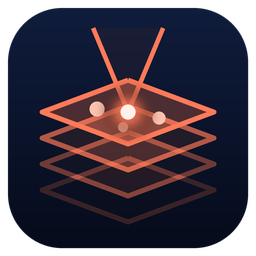
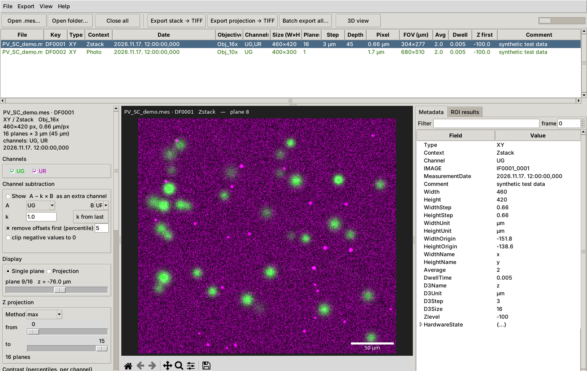

<p align="center"></p>

# MES Viewer

A desktop viewer for **Femtonics MES (.mes)** two-photon recordings: open the files, see every
measurement and its metadata at a glance, browse and project z-stacks, measure polygon ROIs,
clean up the images and export them for Fiji.



## What it does

- **Opens .mes files** — one or many, or a whole folder; both the older MATLAB v5 files and the
  newer MATLAB v7.3 (HDF5) files.
- **Overview table** of every measurement in every open file: type, context, date, objective,
  channels, size, number of planes, z-step, depth, pixel size, field of view, averaging, dwell time,
  z position and comment (sortable, exportable as CSV).
- **Metadata tree** of the full MES header for any measurement and frame, with a filter box
  (exportable as JSON).
- **Viewer** with per-channel contrast and gamma, composite or single channel, µm scale bar,
  position and pixel values under the mouse.
- **Z-projection** — max, mean, sum, SD, median or min over any range of planes.
- **Polygon ROI measurement** — area (µm²), perimeter, mean, SD, min, max, median, integrated density
  and centroid, on a single image, one plane, a projection, or across all planes; results to CSV,
  ROIs to/from JSON.
- **ROI graph** — profile of every ROI across planes (raw, background-ROI subtracted or ΔF/F with
  F0 from the first N points, a percentile or the minimum), or a bar chart of the current image;
  saves PNG/PDF/SVG and the data as CSV.
- **Channel subtraction** — green − k × red as an extra channel (k typed in, or estimated from an
  ROI drawn on an autofluorescent spot), done plane by plane before projecting.
- **Noise reduction** — remove outliers (hot pixels, small specks; ImageJ-style), then Gaussian or
  median smoothing in 2D or 3D. A quick **Preview** filters only the visible plane or projection
  (and only the zoomed region); **Apply** filters the whole stack. ROI numbers stay on the raw data
  unless you choose otherwise.
- **3D view** — rotating max projection with a µm scale bar (savable as a calibrated TIFF rotation),
  orthogonal XY/XZ/YZ views, and its own noise reduction. When run from source with napari
  installed, napari's GPU volume view is used instead.
- **Export** — ImageJ multi-page TIFF hyperstacks (calibrated in µm, z-spacing, green/magenta LUTs),
  one TIFF per channel, noise-reduced stack, projection TIFF, PNG of the view, and batch export of
  every measurement.

## Install

Download the installer for your computer from the
[latest release](https://github.com/jerjely/MES-Viewer/releases/latest):

| Computer | File |
|---|---|
| Windows 10/11 (64-bit) | `MES-Viewer-<version>-Windows-setup.exe` |
| Mac with Apple silicon (M1–M4) | `MES-Viewer-<version>-macOS-AppleSilicon.pkg` |
| Intel Mac | `MES-Viewer-<version>-macOS-Intel.pkg` |

The installers contain everything MES Viewer needs; nothing else has to be installed.

- **Windows:** the installer is per-user and needs no administrator rights. It adds MES Viewer to the
  Start menu, with an optional desktop shortcut and an optional "open .mes files with MES Viewer".
  The installer is not code-signed, so SmartScreen may say *Windows protected your PC*: click
  **More info → Run anyway**.
- **Mac:** the .pkg installs MES Viewer into Applications. It is not signed by an Apple developer,
  so the first time macOS blocks it: open **System Settings → Privacy & Security**, scroll down and
  click **Open Anyway**, then run the installer again.

To uninstall: Windows — *Settings → Apps → MES Viewer → Uninstall*; Mac — drag *MES Viewer* from
Applications to the Bin.

### 3D view and napari

The installers use MES Viewer's built-in 3D viewer (rotating projection, orthogonal views).
[napari](https://napari.org) is **not** included: it is large, depends on Qt and OpenGL drivers and
does not freeze reliably into an installer. To use napari's GPU volume view, run MES Viewer from
source (below) and answer *yes* when the environment installer asks about napari, or add it to an
existing environment:

```
conda install -n mesviewer -c conda-forge napari pyqt
```

View → *3D view (napari if installed)* then opens napari; *3D view (built-in)* always works.
Nothing else in MES Viewer needs a separate driver or compiler.

## Install from source (development)

Needs Python 3.10–3.13 with tkinter (included in conda's Python and the python.org installers).

**With conda (recommended):** install [Miniforge](https://conda-forge.org/download/), then

- Windows: double-click `install_mes_viewer_env.bat` once, then start with `start_mes_viewer.bat`
  (or drag .mes files onto it).
- Mac: double-click `install_mes_viewer_env.command` once, then start with
  `start_mes_viewer.command`. If Finder refuses to run them, in Terminal:
  `chmod +x *.command`.

or by hand:

```
conda env create -f environment.yml
conda activate mesviewer
python mes_viewer.py [file1.mes ...]
```

**With pip:** `python -m pip install -r requirements.txt`, then `python mes_viewer.py`.

Useful commands:

```
python mes_viewer.py --version
python mes_viewer.py --selftest testrun      # synthetic .mes files, full GUI test -> testrun/selftest.txt
python mes_synthetic.py somefolder           # just write the synthetic test files
python -m PyInstaller --noconfirm install/mes_viewer.spec   # build the standalone app locally
python icons/make_icons.py                   # redraw the icon (or --from-png to resize your own)
```

## Making a release

The installers are built by GitHub Actions (`.github/workflows/build-installers.yml`) on Windows,
macOS Apple silicon (`macos-15`) and macOS Intel (`macos-15-intel`). Either

- **push a version tag**, e.g. `v1.0.0` (GitHub Desktop: *History* → right-click the commit →
  *Create Tag…* → `v1.0.0` → *Push origin*), or
- **Actions → Build installers → Run workflow**, and type the version (e.g. `1.0.0`) in the
  *version* box — the workflow then creates the tag and the release itself. With the box left empty
  it only builds and tests; the installers are kept as downloads of that run (*Artifacts*).

The version shown in the window title and Help → About comes from the tag. Every build first runs
the built app's self-test (both .mes layouts: open, overview, projection, ROI across planes, channel
subtraction, noise reduction, TIFF export, graph, 3D view), then installs the installer and runs the
self-test again on the installed app. If anything fails the run stops and no release is made. The
release gets the three files named as in the table above, with short notes on opening unsigned
installers.

## License

MIT — © Gergely Szarka. See [LICENSE](LICENSE).
